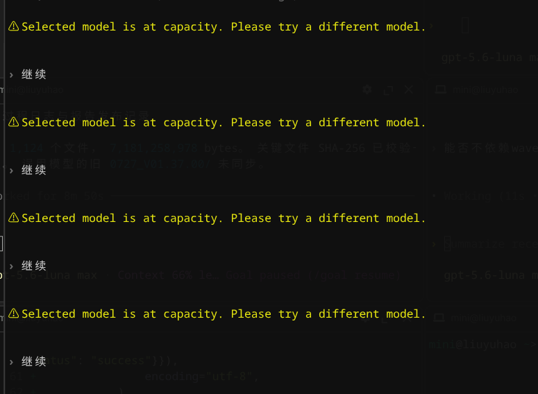
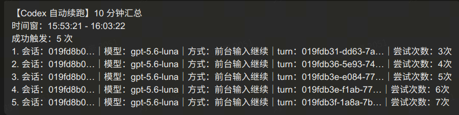
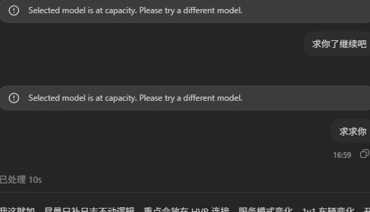
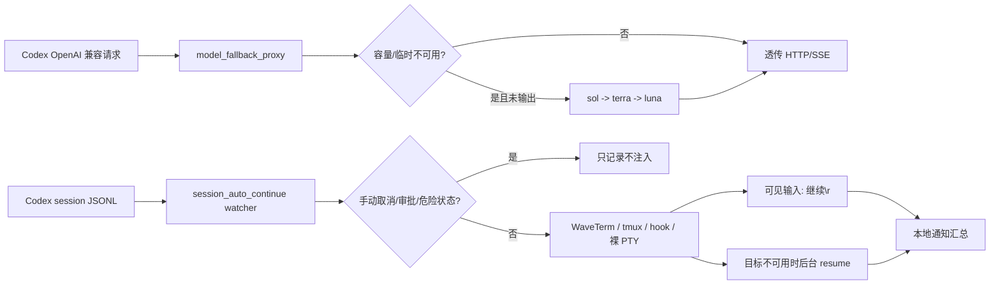

# 继续工程师（JXG）

Continue Engineer：容量不够？继续工程师说：继续。

这是一个可独立复制、独立运行的 Linux 工具，为 Codex 前台会话提供请求级故障转移、失败自动重试、前台可见续跑和本地通知。它不要求 WaveTerm，也不要求飞书；两者只是可选的前端或通知通道。

版本见 `VERSION`，当前模型链固定为：`gpt-5.6-sol → gpt-5.6-terra → gpt-5.6-luna`。到 Luna 后不再降级到 5.5 或其它模型，仍可继续重试当前会话，直到成功或用户手动取消。

## 能力概览

- **请求级容量降级**：代理转发 HTTP 和 SSE 请求；上游返回容量错误、`429`、`503` 或 `529` 且尚未产生有效输出时，自动按模型链重试。
- **SSE 安全处理**：只在响应尚未向下游输出有效正文时切换模型；已有正文或工具输出后不重放，避免重复执行工具和副作用。
- **失败自动重试**：watcher 读取 Codex session JSONL，识别非手动失败并自动继续；不设置 3 次或固定次数上限，退避和幂等控制由状态文件负责。
- **前台可见续跑**：优先向当前 Codex 前端发送固定输入 `继续\r`，用户看到的效果与手动输入一致；无法安全定位前台目标时才使用可控的后台 `codex exec resume` 兜底。
- **多前端支持**：WaveTerm 原生 socket、普通终端 tmux pane、显式虚拟员工 hook，以及受严格开关保护的裸 PTY。`auto` 模式按唯一目标选择通道。
- **本地通知**：成功触发续跑进入汇总队列，默认每 600 秒用 Linux `notify-send` 发一条摘要；无桌面或没有 `notify-send` 时只记录日志，不影响重试。
- **可选飞书通知**：仅当显式选择 `feishu` 并提供 chat id 时调用 `lark-cli`，飞书不是安装或运行依赖。
- **审计与恢复**：状态、事件、前台发现结果和日志写入用户状态目录，支持查看失败原因、触发方式、模型和退避信息。

## 运行效果

容量不足时，前台仍保留可见的 `继续` 输入，效果与用户手动操作一致：



本地 Linux 通知按 10 分钟汇总成功触发记录，避免高频弹窗：



也可以显式切换为飞书通知；飞书只负责展示结果，不参与核心重试链路：



## 实现方案



代理和 watcher 是两个独立进程：

1. `model_fallback_proxy` 在本地监听 `127.0.0.1:4477`，改写请求中的 `model`，检查容量标志和 SSE 事件，并维护模型冷却时间。
2. `session_auto_continue` 只增量读取 `$HOME/.codex/sessions/*.jsonl`，按 session、turn 和事件幂等处理失败；人工取消、审批、危险命令等情况不会自动注入。
3. `foreground_channels` 负责目标发现和安全门禁，`waveterm_foreground` 只封装 WaveTerm 协议；不使用 WaveTerm 时这两个模块仍可通过 tmux 或 hook 工作。
4. 通知由 watcher 内置的本地发送器完成。飞书适配器是显式选择的可选分支，不在导入阶段加载 `lark-cli`。

## 平台和依赖

支持目标：

- Linux，推荐带用户级 systemd 和桌面通知服务的发行版。
- Python 3.10 或更高版本。
- Python 运行依赖仅为 `aiohttp`，详见 `requirements.txt`。
- `systemd --user` 用于常驻服务；没有 systemd 时可直接运行 runtime 脚本。
- WaveTerm、tmux、`notify-send`、`lark-cli` 都是可选能力：缺失时对应通道关闭或记录 `observe_only`，不会阻止代理启动。

## 仓库结构

- `src/model_fallback_proxy/`：代理、watcher、前台通道和 WaveTerm 适配器。
- `tests/`：单元测试和协议模拟测试。
- `scripts/runtime/`：`run_proxy.sh`、`run_watcher.sh`。
- `scripts/quality/`：统一质量门禁。
- `configs/`：脱敏配置模板。
- `systemd/`：两个用户级服务模板。
- `docs/`：迁移文档和文档索引。

## 安装

```bash
git clone <仓库地址> "$HOME/model_fallback_proxy_standalone"
cd "$HOME/model_fallback_proxy_standalone"
python3 -m venv .venv
.venv/bin/python -m pip install -r requirements.txt

mkdir -p "$HOME/.config/codex-model-fallback-proxy-standalone"
install -m 600 configs/environment.example \
  "$HOME/.config/codex-model-fallback-proxy-standalone/environment"
# 编辑上面的 environment，至少填写 CODEX_FALLBACK_UPSTREAM_URL。

mkdir -p "$HOME/.config/systemd/user"
ln -sf "$PWD/systemd/codex-model-fallback-proxy.service" \
  "$HOME/.config/systemd/user/codex-model-fallback-proxy.service"
ln -sf "$PWD/systemd/codex-session-auto-continue.service" \
  "$HOME/.config/systemd/user/codex-session-auto-continue.service"
systemctl --user daemon-reload
systemctl --user enable --now codex-model-fallback-proxy.service
systemctl --user enable --now codex-session-auto-continue.service
```

把 Codex 的 OpenAI 兼容 `base_url` 指向 `http://127.0.0.1:4477/v1` 或实际使用的代理路径。代理上游地址放在外置 environment 中，仓库只保存占位模板。

## 不使用 systemd 或 WaveTerm

普通终端可以直接运行：

```bash
cd "$HOME/model_fallback_proxy_standalone"
CODEX_FALLBACK_UPSTREAM_URL="https://api.example.invalid" \
  scripts/runtime/run_proxy.sh

CODEX_AUTO_CONTINUE_FRONTEND_CHANNEL=terminal \
  CODEX_AUTO_CONTINUE_FOREGROUND=1 \
  scripts/runtime/run_watcher.sh
```

普通终端建议在 tmux 中运行 Codex：

```bash
tmux new-session -A -s codex
codex
```

裸 PTY 注入默认关闭，必须同时显式打开 `CODEX_AUTO_CONTINUE_TERMINAL_PTY=1` 和 `CODEX_AUTO_CONTINUE_TERMINAL_ASSUME_READY=1`；内核禁用 `TIOCSTI` 时会自动放弃该通道。

## 配置要点

完整模板见 `configs/environment.example`。常用项：

- `CODEX_FALLBACK_UPSTREAM_URL`：必填，上游 HTTP/S 地址，禁止内嵌 userinfo。
- `CODEX_FALLBACK_MODEL_CHAIN`：模型链，默认 sol、terra、luna。
- `CODEX_AUTO_CONTINUE_FOREGROUND`：是否允许前台可见输入。
- `CODEX_AUTO_CONTINUE_BACKGROUND_FALLBACK`：前台目标不可用时是否允许后台 resume 兜底。
- `CODEX_AUTO_CONTINUE_FRONTEND_CHANNEL`：`auto`、`waveterm`、`terminal`、`virtual_employee`。
- `CODEX_AUTO_CONTINUE_NOTIFICATION_CHANNEL`：`local`、`feishu` 或 `none`，默认 `local`。
- `CODEX_AUTO_CONTINUE_NOTIFY_INTERVAL`：通知汇总窗口，默认 600 秒。
- `CODEX_AUTO_CONTINUE_FEISHU_NOTIFY`：旧配置兼容项；只有显式启用且有 chat id 才走飞书。

## 状态、日志与排障

运行状态默认位于：

- `$HOME/.local/state/codex-session-auto-continue/state.json`
- `$HOME/.local/state/codex-session-auto-continue/events.jsonl`
- `$HOME/.local/state/codex-session-auto-continue/foreground.json`
- `$HOME/.local/state/codex-session-auto-continue/logs/`

```bash
systemctl --user status codex-model-fallback-proxy.service --no-pager
systemctl --user status codex-session-auto-continue.service --no-pager
curl -fsS http://127.0.0.1:4477/_fallback/status
journalctl --user -u codex-model-fallback-proxy.service -n 100 --no-pager
journalctl --user -u codex-session-auto-continue.service -n 100 --no-pager
```

看到 `observe_only` 时，先检查 session、PTY、cwd 和 block 是否唯一；看到 `failed` 时，检查对应前端进程是否仍存在。通知缺失不等于续跑失败，应先看 `events.jsonl` 和 systemd 日志。

## 验证与质量门禁

统一执行：

```bash
cd "$HOME/model_fallback_proxy_standalone"
scripts/quality/check_repo_quality.sh
```

该门禁包含 shell 语法、Python 编译、51 项单元测试、`git diff --check` 和脱敏/私有路径扫描。只读扫描 watcher：

```bash
CODEX_AUTO_CONTINUE_FOREGROUND=0 \
CODEX_AUTO_CONTINUE_BACKGROUND_FALLBACK=0 \
  scripts/runtime/run_watcher.sh --once
```

## 安全和独立性

- 仓库不包含真实上游地址、token、cookie、飞书 chat id 或本机私有路径。
- 真实环境文件在 `$HOME/.config/...`，权限应为 `600`，systemd 以用户身份读取。
- 前台注入前复核 session、进程、PTY、cwd 和 WaveTerm block 身份；固定 payload 只允许 `继续\r`。
- 后台兜底使用参数化 `codex exec resume`，不拼接 shell 命令，不把凭据写入 argv、状态或日志。
- 删除服务只需 `systemctl --user disable --now ...`；状态和日志默认保留，便于审计和回滚。

## 迁移和贡献

从旧版后台续跑迁移请阅读 `docs/migration.md`。贡献规则见 `CONTRIBUTING.md`：`main` 仅接受 Pull Request，禁止直接推送；提交前必须通过 `scripts/quality/check_repo_quality.sh`。不要提交 `.env`、`.venv`、状态目录、日志或本地计划文件。
